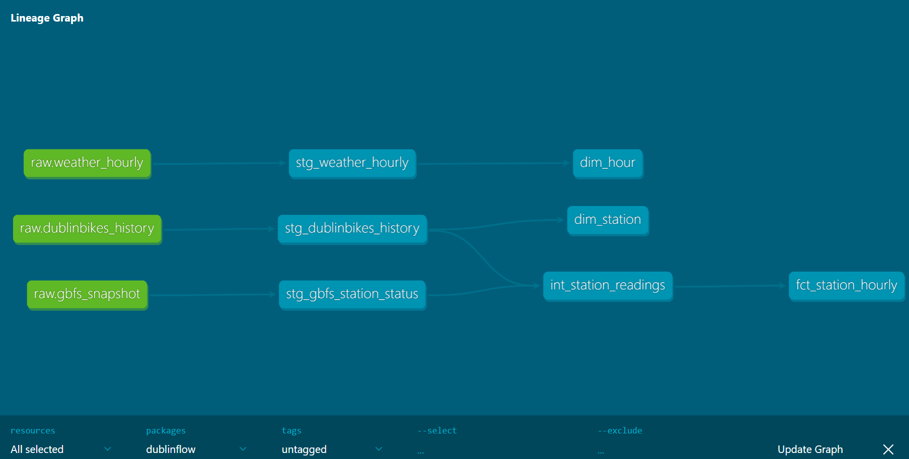
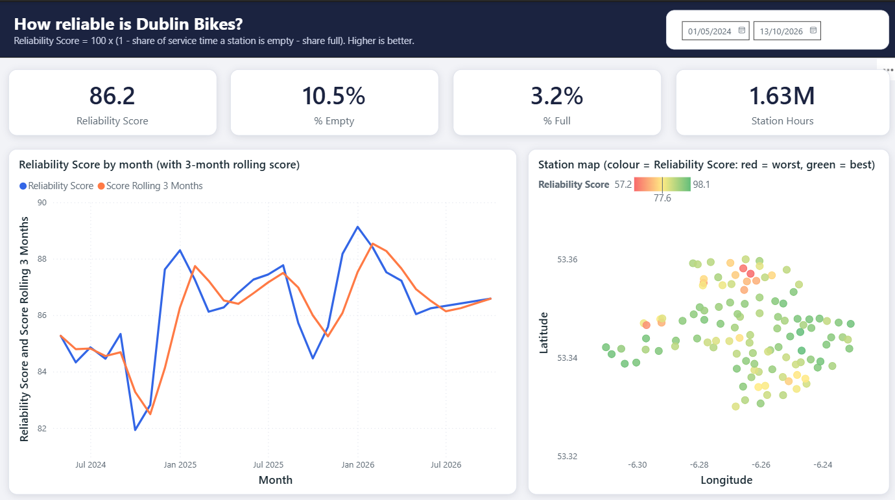
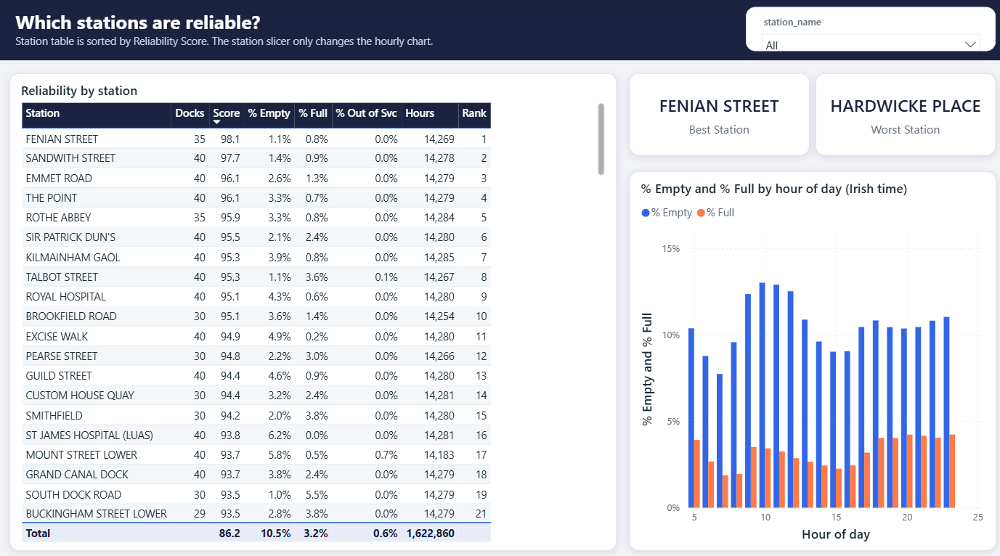
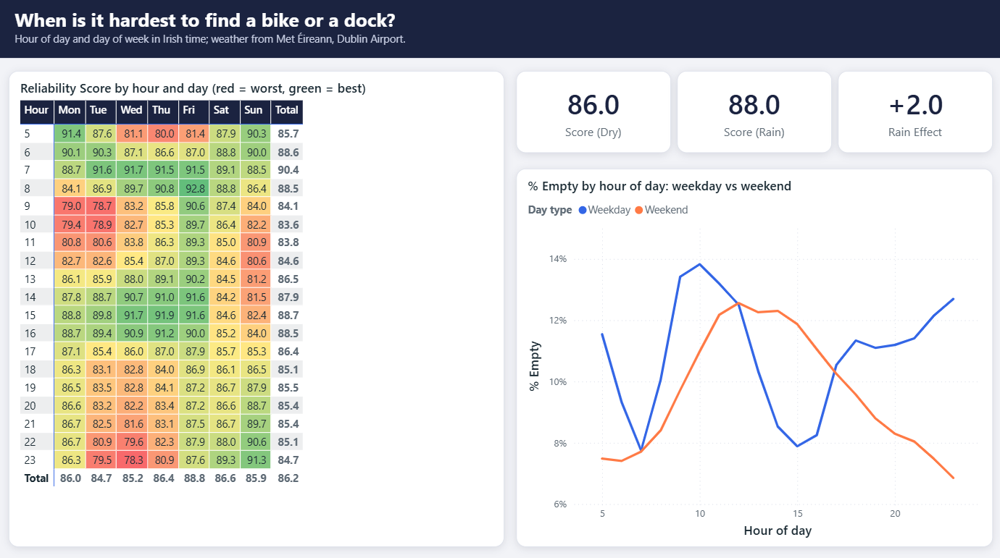
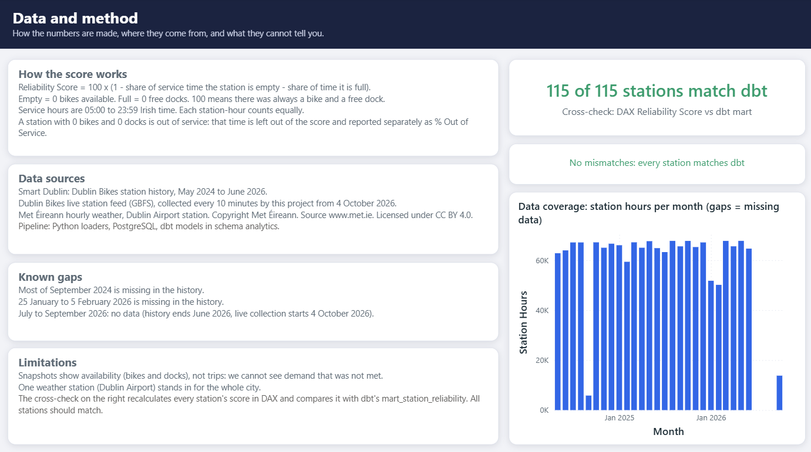

# DublinFlow: Dublin Bikes Reliability Data Platform

[](https://github.com/rdsayanth/dublinflow/actions/workflows/ci.yml)

> Work in progress. Done: live collection, raw data layer, 2 years of history and weather, a tested dbt star schema, SQL analysis, a Power BI report and a daily automated refresh.

## The question

How reliable is it to find a bike, or a free dock, at a Dublin Bikes station?
And how do weather, time of day and location change that?

## What this project does

An end-to-end data pipeline:

1. A Python collector reads the live Dublin Bikes feed every 10 minutes (GitHub Actions, triggered by cron-job.org) and saves the raw JSON to Azure Blob Storage.
2. Python loaders bring the raw files, 2 years of Smart Dublin station history and Met Éireann hourly weather into PostgreSQL.
3. dbt models clean, join and test the data (staging, intermediate, marts).
4. SQL analysis calculates a Reliability Score for each station.
5. A Power BI report presents the findings.

See [docs/architecture.md](docs/architecture.md) for the design and [docs/data_quality.md](docs/data_quality.md) for data checks and known gaps.

## Data model (dbt)



| Layer | Model | What it holds |
|---|---|---|
| Staging (views) | `stg_dublinbikes_history` | Smart Dublin history, typed, one row per station per snapshot |
| | `stg_gbfs_station_status` | Live feed JSON unpacked, one row per station per snapshot |
| | `stg_weather_hourly` | Met Éireann hourly weather, typed |
| Intermediate (view) | `int_station_readings` | History and live readings combined, with a `data_source` column |
| Marts (tables) | `fct_station_hourly` | Fact: one row per station per hour (bikes available, share of time empty, full, not renting) |
| | `dim_hour` | Every hour since May 2024 in UTC and Irish local time, with weather |
| | `dim_station` | One row per station: name, location, capacity |

Tests check uniqueness, missing values and the links from the fact table to both dimensions. A source freshness check warns if no live snapshot has arrived for 2 days.

## Reliability Score

`100 × (1 − share of time empty − share of time full)`, measured during service hours.
Empty % and full % are also reported separately.

## Power BI report

A 4-page report in [`powerbi/`](powerbi/), saved as a Power BI Project (`.pbip`): the semantic model is plain-text TMDL and the report is PBIR JSON, so every change shows up as a readable git diff. Import mode, connected to the dbt `analytics` schema; 22 DAX measures in a Measures folder. Model, measures and design decisions: [docs/powerbi.md](docs/powerbi.md).

**Overview:** score over time and a station map coloured by score.


**Stations:** every station ranked, best and worst station, and the share of time empty or full by hour of day.


**Time and weather:** hour × day heatmap, weekday vs weekend, and dry vs rain.


**Data and method:** how the score works, sources, known gaps, a data coverage chart, and a cross-check that recalculates every station's score in DAX and compares it with dbt's `mart_station_reliability` (115 of 115 match).


What it shows (May 2024 to Oct 2026, service hours):

- The network scores **86.2**: stations are empty 10.5% of the time and full 3.2%.
- **Weekday commute peaks are the hardest**: Monday and Tuesday at 09:00–10:00 score about 79, and late evenings are just as low (Wednesday 23:00 is the lowest hour, 78.3). Around 07:00 and on Wednesday to Friday afternoons it is easiest (about 91).
- At weekends the low point comes later: Sunday 10:00–13:00 scores 81–82.
- **Rainy hours score slightly higher** (88.0 vs 86.0 dry), most likely because fewer people ride (season not controlled for).
- The best station is Fenian Street (98.1) and the worst is Hardwicke Place (57.2).

To open it: install Power BI Desktop, open `powerbi/DublinFlow.pbip`, click **Refresh** and sign in to PostgreSQL with the user from your `.env`.

## Tech stack

Python 3.12 · requests · psycopg · PostgreSQL · dbt Core · GitHub Actions · Azure Blob Storage · Power BI

## Repository structure

```
ingestion/          Python collector, downloaders and loaders
sql/                DDL and analysis queries
dbt/                dbt project (models and tests)
tests/              pytest tests for the collector and loaders (no network or database needed)
powerbi/            Power BI Project (TMDL model, PBIR report)
scripts/            Warehouse refresh script (load + dbt build), run daily by Task Scheduler
docs/               Architecture, data quality, data dictionary, findings, screenshots
.github/workflows/  GitHub Actions schedules
```

## Getting started (Windows)

```
git clone https://github.com/rdsayanth/dublinflow.git
cd dublinflow
py -3.12 -m venv .venv
.\.venv\Scripts\Activate.ps1
python -m pip install -r requirements.txt
```

Copy `.env.example` to `.env` and fill in the values. Create the tables by running the files in `sql/raw/` against a `dublinflow` database, then:

```
python ingestion/load_raw_to_postgres.py        # live snapshots from Azure Blob
python ingestion/download_history.py            # Smart Dublin monthly CSVs
python ingestion/load_history_to_postgres.py
python ingestion/load_weather_to_postgres.py    # Met Éireann hourly weather
```

Then build and test the dbt models (run from the repo root; `dotenv run` loads `.env` so dbt finds the project and the database):

```
dotenv run -- dbt debug                 # check the connection
dotenv run -- dbt build                 # build all models and run all tests
dotenv run -- dbt source freshness      # check the live data is recent
dotenv run -- dbt docs generate         # build the documentation site
dotenv run -- dbt docs serve            # open it in the browser
```

## Running the tests

```
python -m pip install -r requirements-dev.txt
pytest
```

The tests use small sample data and fakes, so they need no network, Azure or database. GitHub Actions ([`ci.yml`](.github/workflows/ci.yml)) runs them on every push, together with `dbt parse` to check that every dbt model, test and source compiles.

## Refreshing the data

The live feed is collected automatically every 10 minutes by GitHub Actions. To bring it into the warehouse, run one script:

```
powershell -NoProfile -ExecutionPolicy Bypass -File scripts\refresh_warehouse.ps1
```

It loads new live snapshots, reloads the weather every 30 days (add `-Weather` to force it), runs `dbt build` (all models and tests) and `dbt source freshness`, and writes a log to `logs\refresh\`. It stops at the first failure and exits with code 1. Windows Task Scheduler runs it every morning. Then open `powerbi\DublinFlow.pbip` and click **Refresh**: Power BI Desktop cannot refresh on a schedule (that needs the Power BI service).

## Data sources and attribution

- **Dublin Bikes live station feed (GBFS)**: station status and station information, collected every 10 minutes.
- **Smart Dublin**: historical Dublin Bikes station data, May 2024 to June 2026 ([dataset](https://data.smartdublin.ie/dataset/dublinbikes-api)).
- **Met Éireann**: hourly weather observations for Dublin Airport (station 532).
  Copyright Met Éireann. Source: [www.met.ie](https://www.met.ie). Licensed under [CC BY 4.0](https://creativecommons.org/licenses/by/4.0/) ([Met Éireann data licence](https://clidata.met.ie/cli/climate_data/showdata.php?action=data&file=Data_Licence.pdf)).
  This project aggregates the data by hour and joins it with bike availability.

## Author

Sayanth Rajani Divakaran · [GitHub](https://github.com/rdsayanth)